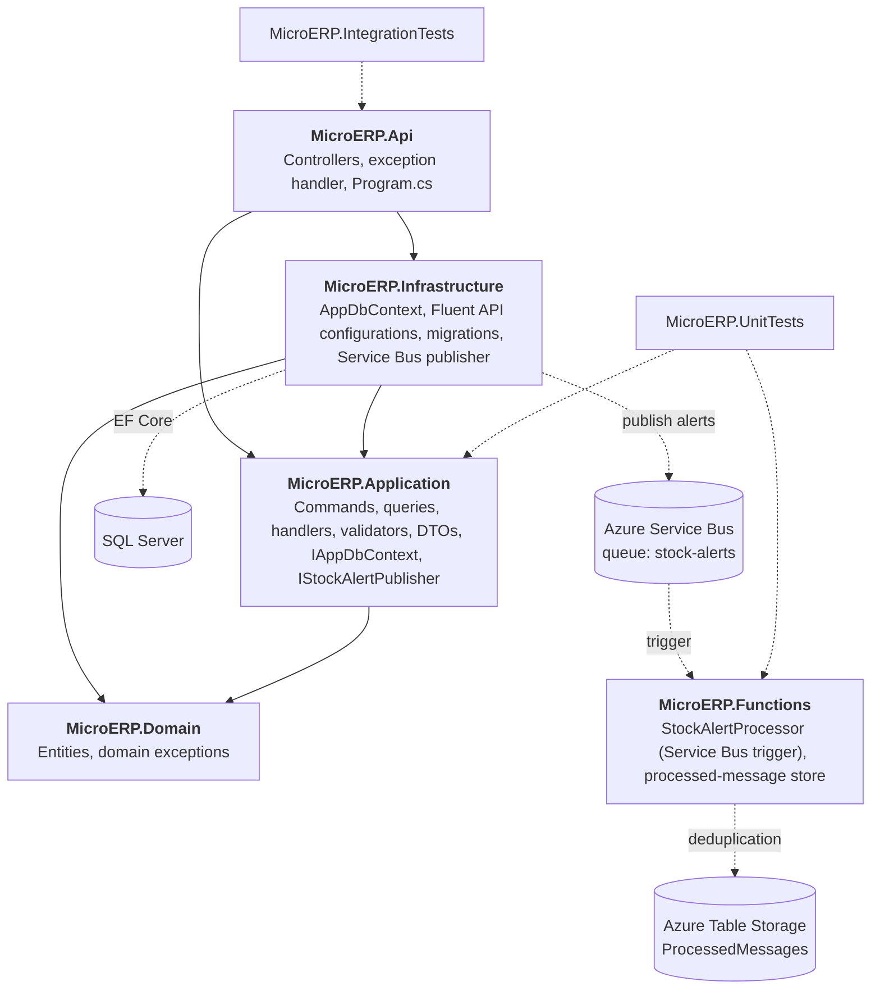
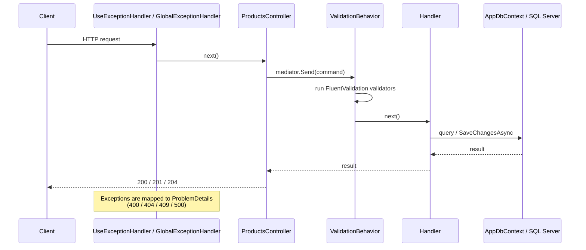
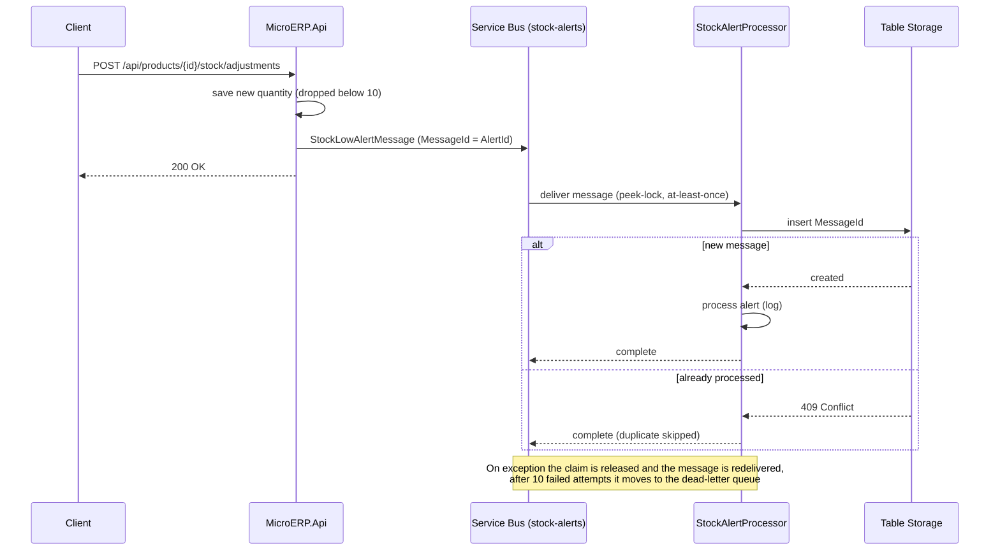
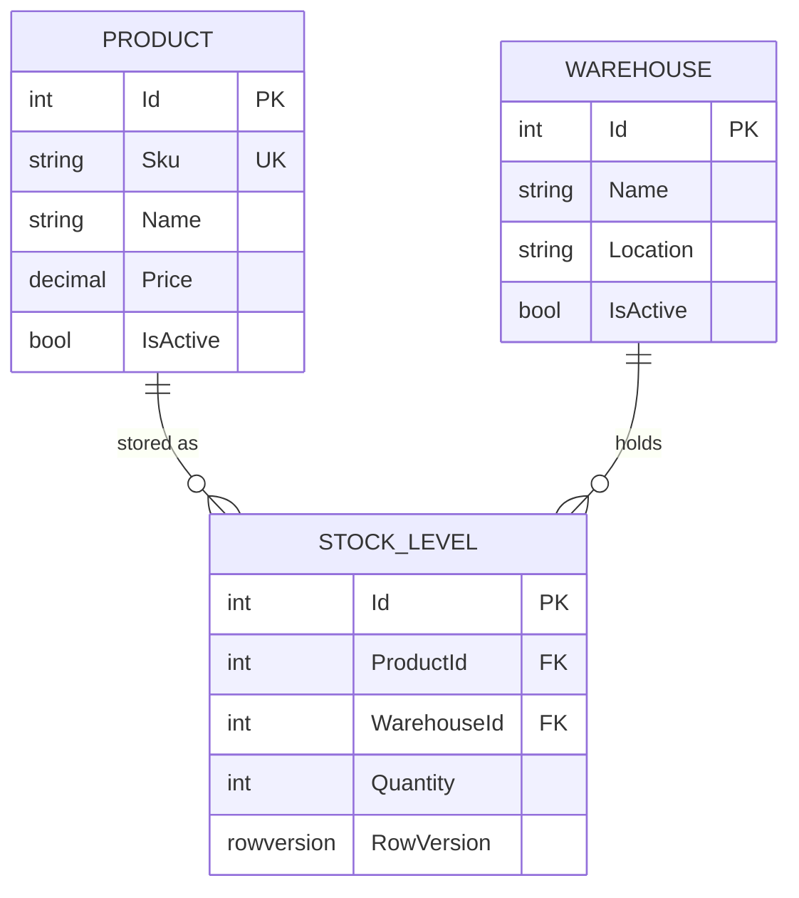

# MicroERP


Warehouse & inventory REST API built with ASP.NET Core 10 and Clean Architecture.

A portfolio project focused on code quality and Microsoft standards rather than feature count:
layered architecture, CQRS-style request handling, validation pipeline, RFC 7807 error responses,
unit + integration tests against a real SQL Server, Docker, CI, and an Azure Service Bus + Azure Functions integration
with idempotent message processing.

## Stack

| Area | Technology |
|---|---|
| Framework | ASP.NET Core 10 |
| ORM | EF Core 10 (Code First, migrations, Fluent API) |
| Database | SQL Server 2022 |
| Request handling | MediatR (Command/Query + Handler) |
| Validation | FluentValidation (MediatR pipeline behavior) |
| Messaging | Azure Service Bus (low-stock alerts) |
| Serverless | Azure Functions (.NET isolated worker, Service Bus trigger), Azure Table Storage (idempotency) |
| API docs | Swagger / OpenAPI (Swashbuckle, XML comments) |
| Unit tests | xUnit, Moq, FluentAssertions |
| Integration tests | WebApplicationFactory, Testcontainers (SQL Server) |
| DevOps | Docker, docker compose, Azurite, GitHub Actions, CodeQL, Dependabot |

## Getting Started

### Prerequisites

- [Docker Desktop](https://www.docker.com/products/docker-desktop/) - required to run the app in containers **and** to run integration tests
- [.NET 10 SDK](https://dotnet.microsoft.com/download) - only needed for local development and tests
- [Azure Functions Core Tools v4](https://learn.microsoft.com/azure/azure-functions/functions-run-local) - only needed to run the Azure Function (Option C)
- An Azure subscription - optional; without it low-stock alerts are only logged by the API

### Option A - run everything in Docker (no .NET SDK needed)

```bash
git clone https://github.com/Nerso1/MicroERP.git
cd MicroERP
cp .env.example .env
docker compose up --build
```

Open **http://localhost:8080/swagger**.

The API waits for SQL Server to pass its health check, then applies EF Core migrations
(including seed data) on startup. Host ports can be changed in `.env` (`API_PORT`, `DB_PORT`).
To send low-stock alerts to a real Azure Service Bus queue, set `AZURE_SERVICEBUS_CONNECTION_STRING` in `.env`
(otherwise they are only logged). The Azure Function is not part of docker compose - see Option C.

Stop with `Ctrl+C`; remove containers with `docker compose down` (add `-v` to also delete the database and Azurite volumes).

### Option B - local development (`dotnet run`)

```bash
git clone https://github.com/Nerso1/MicroERP.git
cp .env.example .env
docker compose up -d db                     # Docker for SQL Server only
dotnet tool install --global dotnet-ef      # once
dotnet ef database update --project src/MicroERP.Infrastructure --startup-project src/MicroERP.Api
dotnet run --project src/MicroERP.Api --launch-profile https
```

Open **https://localhost:5101/swagger**.

Optional - send low-stock alerts to a real Azure Service Bus queue (without it alerts are only logged):

```bash
dotnet user-secrets set "AzureServiceBus:ConnectionString" "<connection-string>" --project src/MicroERP.Api
```

### Option C - stock alert processing (Azure Function)

The function `StockAlertProcessor` receives low-stock alerts from the queue. It needs:

1. **Azure Service Bus** - a namespace (Basic tier is enough) with a queue named `stock-alerts` and two SAS policies on the queue:
   one with **Send** for the API (Option A/B) and one with **Listen** for the function.
2. **Azurite** - the local Azure Storage emulator, used by the Functions host and for the idempotency table:

```bash
docker compose up -d azurite
cp src/MicroERP.Functions/local.settings.example.json src/MicroERP.Functions/local.settings.json
# set "AzureServiceBus" in local.settings.json to the Listen policy connection string
cd src/MicroERP.Functions
dotnet run
```

Run it next to the API (Option B, second terminal) and adjust a stock level below 10 -
the function logs `Low stock: product ... in warehouse ... has ... units`.
Messages sent while the function is not running wait in the queue and are processed on the next start.

> `dotnet run` has to be started from the function's directory - with `--project` from the repository root
> the Functions SDK resolves its output directory relative to the current directory and fails.

### Running tests

```bash
dotnet test
```

Integration tests start their own SQL Server container via Testcontainers - Docker Desktop must be running.
Unit tests (including the Azure Function) need neither Docker nor Azure.

### API endpoints

| Method | Route | Description |
|---|---|---|
| `GET` | `/api/products?page=1&pageSize=10&search=` | Paginated product list with optional search |
| `GET` | `/api/products/{id}` | Single product |
| `POST` | `/api/products` | Create product -> `201 Created` |
| `PUT` | `/api/products/{id}` | Update product -> `204 No Content` |
| `DELETE` | `/api/products/{id}` | Delete product -> `204 No Content` |
| `GET` | `/api/products/{id}/stock` | Stock levels of a product across warehouses |
| `POST` | `/api/products/{id}/stock/adjustments` | Change stock in one warehouse by `quantityChange` (+/-) -> `200` with the new quantity |

Errors are returned as `application/problem+json` (RFC 7807):
`400` validation errors, `404` not found, `409` duplicate SKU / insufficient stock / concurrent update, `500` unexpected error.

## Architecture

### Project dependencies

Dependencies point inwards - `Domain` knows nothing about EF Core, MediatR or ASP.NET Core.



`Application` defines the `IAppDbContext` interface; `Infrastructure` implements it with EF Core.
The dependency is inverted, so handlers can be unit-tested with a mocked context.
`MicroERP.Functions` is a separate deployable with no reference to the API projects - it only shares the message format.

### Request flow



### Low-stock alert flow



### Data model



Tables live in two schemas: `Products.Products`, `Products.StockLevels`, `Settings.Warehouses`.
All entities implement `IAuditable` - `CreatedAt` / `UpdatedAt` are set automatically in `SaveChangesAsync`.

### Solution layout

```
src/
├── MicroERP.Domain/          # Entities, IAuditable, domain exceptions - no external dependencies
├── MicroERP.Application/     # CQRS commands/queries, handlers, validators, DTOs, IAppDbContext
├── MicroERP.Infrastructure/  # EF Core (AppDbContext, configurations, migrations), Service Bus publisher
├── MicroERP.Api/             # Controllers, GlobalExceptionHandler, Program.cs, Dockerfile
└── MicroERP.Functions/       # Azure Function: Service Bus trigger, Table Storage deduplication
tests/
├── MicroERP.UnitTests/         # Handlers, validators and the Azure Function with mocked dependencies
└── MicroERP.IntegrationTests/  # Full HTTP flow against SQL Server in Testcontainers
```

## Design Decisions

**Monolith, not microservices.** One consistent domain (products and warehouses) in one database.
Splitting it into services just to use a message broker would add distributed-system complexity with no benefit at this scale.

**CQRS light.** MediatR organises code into Command/Query + Handler, one use case per class.
There are no separate read/write models or databases - this is a code-organisation pattern, not an architectural necessity here.

**`IAppDbContext` instead of Repository + Unit of Work.** `DbContext` already is a unit of work and `DbSet` already is a repository.
A thin interface exists only so handlers can be unit-tested with mocks.

**Validation in the MediatR pipeline.** A generic `ValidationBehavior` runs FluentValidation validators before every handler,
so controllers and handlers contain no validation code. Fluent API (not Data Annotations) keeps `Domain` free of EF Core attributes.

**One place for error handling.** `GlobalExceptionHandler` (`IExceptionHandler` + `AddProblemDetails`) maps exceptions to RFC 7807 `ProblemDetails`,
so every error response - thrown or returned by a controller - has the same shape: `type`, `title`, `status`, `detail`, `traceId`.
A duplicate SKU is enforced by a unique index in the database and surfaces as `409 Conflict`.

**Manual pagination instead of OData.** `PagedResult<T>` with `Skip`/`Take` on `IQueryable` - OData would be too heavy for a handful of tables.

**Optimistic concurrency on stock.** `StockLevel.RowVersion` is a SQL Server `rowversion` column. Two concurrent adjustments of the same stock level
cannot both succeed - the second one gets `409 Conflict` instead of silently overwriting the first.

**Low-stock alerts through Azure Service Bus.** When a stock adjustment drops the quantity below 10, the API publishes a `StockLowAlertMessage`
to the `stock-alerts` queue. The alert is sent only when the threshold is crossed (12 -> 9, not again for 9 -> 7).
`Application` only knows the `IStockAlertPublisher` interface; the Service Bus implementation lives in `Infrastructure`,
and without a configured connection string a logging implementation is used, so the project runs without an Azure account.
The alert is published after the stock change is saved, and a publishing failure is logged instead of failing the request
(a retried request would adjust the stock twice). Known limitation: an alert can be lost if the process stops between saving and publishing -
the full solution would be a transactional outbox, which is out of scope here.

**Idempotent alert processing.** Service Bus delivers messages at least once, so the function may receive the same alert twice.
It claims each `MessageId` with an atomic insert into Azure Table Storage - a duplicate fails with `409 Conflict` and is skipped.
If processing fails, the claim is released and the message is retried (dead-lettered after 10 attempts);
if Table Storage is unavailable, the function fails closed instead of processing without a duplicate check.
Table Storage needs no extra resource (the Functions host already uses a Storage Account), unlike Service Bus duplicate detection,
which also only catches duplicate sends, not redeliveries.

**The function does not reference `Application`.** It owns a copy of `StockLowAlertMessage`: sender and receiver share a JSON contract,
not a class, and the function does not pull in EF Core, MediatR or FluentValidation.

**Least-privilege queue access.** The API uses a SAS policy with only the Send right, the function one with only Listen -
each key can be regenerated independently, and a leaked key cannot be used for anything else.
Cloud deployment will replace the keys with managed identities.

**Integration tests on real SQL Server (Testcontainers), not SQLite or InMemory.** SQLite does not support `rowversion`,
behaves differently with `decimal` and text comparison, and does not test migrations. With Testcontainers only the connection string is replaced -
the same provider and the same migrations as in production.

**Migrations on startup - opt-in.** Enabled with `Database:MigrateOnStartup=true` (set in `docker-compose.yml`), disabled by default.
Convenient for a one-command demo; in a cloud deployment migrations will run as a separate pipeline step.

**Authentication deferred to Stage 3.** A deliberate choice, not an omission. Dependencies flow through interfaces,
so adding ASP.NET Identity + JWT means changing `AppDbContext` and `Program.cs` without touching business logic.

**Secrets.** Nothing secret is committed. Local Docker settings (SA password, optional Service Bus connection string) live in a git-ignored `.env`
(`.env.example` is committed), the API's Service Bus connection string in User Secrets,
and the function's settings in a git-ignored `local.settings.json` (`local.settings.example.json` is committed).
Cloud deployment (Stage 2) will use App Service settings and managed identities instead.

## Roadmap

- [x] **Stage 1 - Foundation:** Clean Architecture, EF Core, CQRS, validation, tests, Docker, CI
- [ ] **Stage 2 - Azure:** Service Bus (low-stock alerts), Azure Function, App Service + Azure SQL deployment
- [ ] **Stage 3 - Auth:** ASP.NET Identity + JWT
- [ ] **Stage 4 - Extras:** stock movements with transactions, Serilog, OpenTelemetry, rate limiting, CORS

## License

[MIT](LICENSE)
